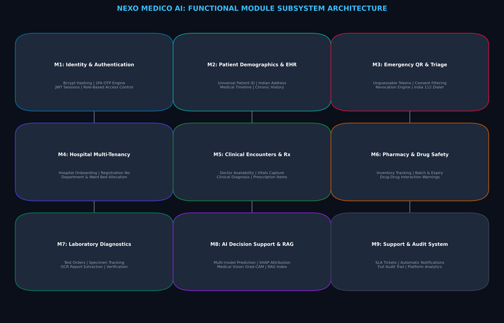
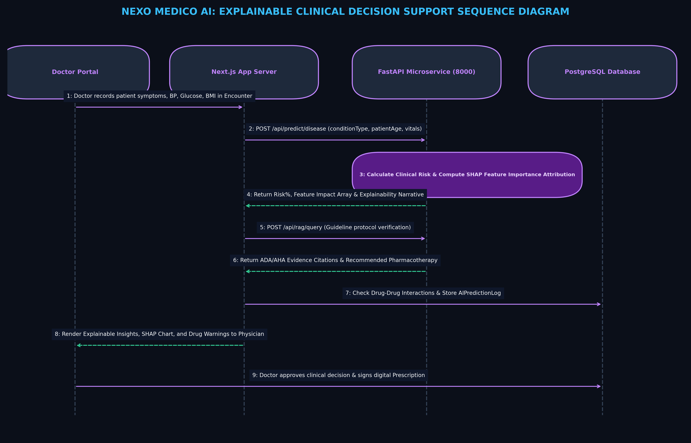
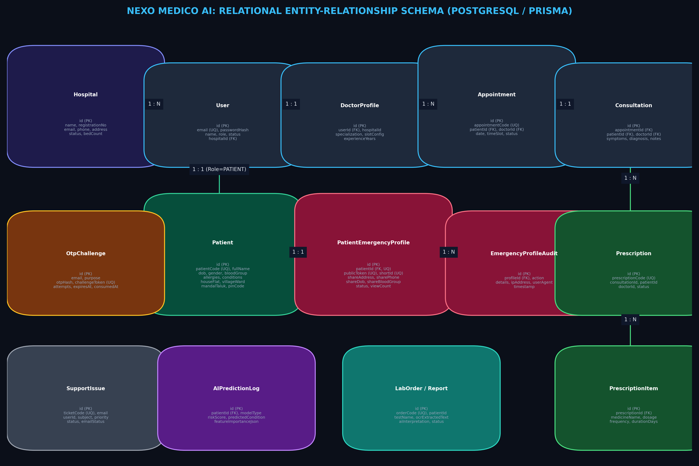
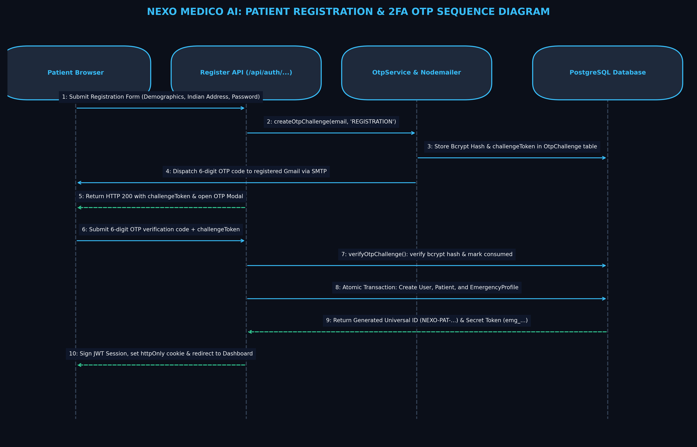
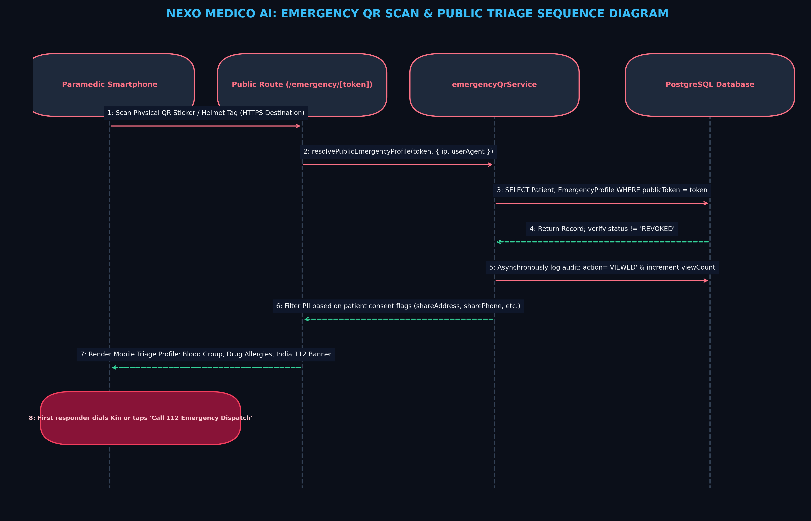
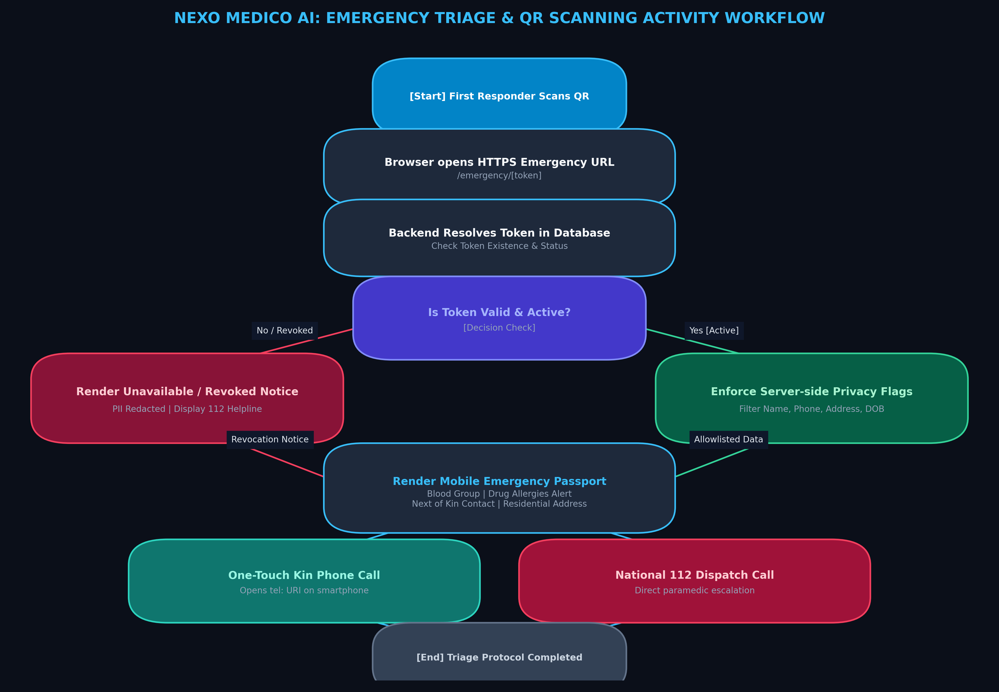
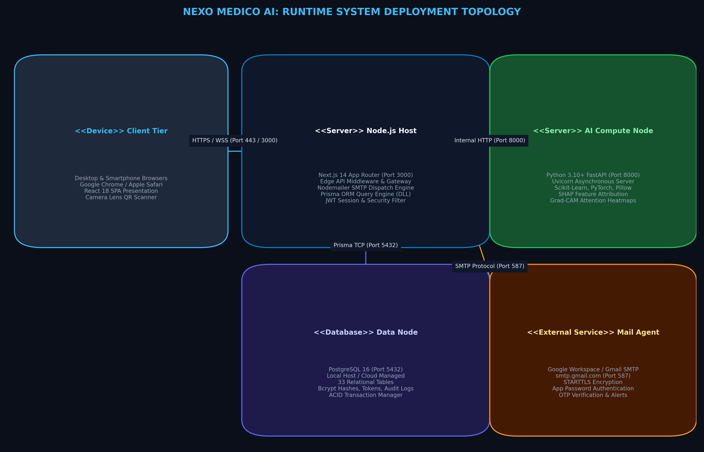

# Nexo Medico AI — System Architecture & Design Specification

## 1. Architectural Philosophy & High-Level Topology

Nexo Medico AI is engineered using a decoupled, service-oriented four-tier architecture designed for high availability, strict patient data isolation, sub-50ms API responsiveness, and explainable artificial intelligence (XAI).

```
+-----------------------------------------------------------------------------------+
|                            1. Client Presentation Tier                            |
|  Patients | Doctors | Triage Nurses | Hospital Admins | Pharmacists | First Responders |
|  - Next.js 14 App Router, React Server Components (RSC), Tailwind CSS, Lucide     |
+-----------------------------------------------------------------------------------+
                                        | (HTTPS / TLS 1.3)
+-----------------------------------------------------------------------------------+
|                        2. Application & API Gateway Tier                         |
|  Next.js 14 Web Server (Node.js 20 LTS Active)                                    |
|  - Role-Based Access Control (RBAC), JWT Authentication, Zod Schema Validation    |
|  - Server Actions, RESTful Route Handlers, CSRF & Timing-Safe Comparators         |
+-----------------------------------------------------------------------------------+
                   |                                       |
                   v                                       v (Internal REST / JSON)
+----------------------------------------+   +--------------------------------------+
|       3. Persistence Layer             |   |    4. AI & Machine Learning Tier     |
|  PostgreSQL 15 (Relational Data)       |   |  Python 3.11 FastAPI Microservice    |
|  - Managed via Prisma ORM 5.22         |   |  - Port 8000 (Async Uvicorn workers) |
|  - 33 Multi-Tenant Models              |   |  - Disease Triage & SHAP Explainer   |
|  - Row-Level Hospital Scoping          |   |  - Tesseract OCR Pathology Extraction|
+----------------------------------------+   +--------------------------------------+
                   |
                   v (Port 587 STARTTLS)
+----------------------------------------+
|      External Communication Gateway    |
|  Google SMTP Cluster (smtp.gmail.com)  |
|  - Cryptographic 6-Digit 2FA OTPs      |
|  - Automated Clinical Notifications   |
+----------------------------------------+
```

---

## 2. Four-Tier Architectural Model

### Tier 1: Client Presentation Tier
- **Framework**: Next.js 14 with React 18, utilizing the React Server Components (RSC) paradigm.
- **Styling & UI**: Tailwind CSS, Lucide React icons, and Recharts for interactive data visualization.
- **Roles Served**:
  - **Patient**: Universal Health Passport, appointment booking, India-specific onboarding, Emergency QR generation.
  - **Doctor**: Clinical encounter chamber, longitudinal EHR timeline, CDSS AI disease risk evaluation, structured e-prescribing.
  - **Hospital Administrator**: Multi-tenant ward bed allocation (General, Semi-Private, ICU), staff credentials, inter-hospital referrals.
  - **Pharmacist**: E-prescription ingestion, real-time batch inventory decrement, dispensing audit log.
  - **Laboratory Technician**: Diagnostic test worklists, specimen status updates, OCR-assisted report digitization.
  - **First Responder / Paramedic**: Zero-friction Emergency QR scanner resolving life-saving medical profiles on any smartphone browser.


### Tier 2: Application Gateway & Business Logic Tier
- **Runtime**: Node.js 20 LTS executing Next.js App Router route handlers and server actions.
- **Authentication**: JWT-based stateless session management with HTTP-only, SameSite secure cookies.
- **Geographic Validation**: Custom India geographic validation engine (`src/lib/indiaGeoData.ts`) strictly verifying 36 States/UTs, official district databases, and 6-digit postal PIN codes.
- **Emergency QR Token Engine**: Unguessable 64-character hexadecimal tokens generated via `crypto.randomBytes(32)` providing zero-trust emergency record lookups.



### Tier 3: Asynchronous AI & Decision Support Microservice
- **Runtime**: Python 3.11 with FastAPI 0.110+ running under Uvicorn.
- **Core Endpoints**:
  - `/api/predict/disease`: Ingests clinical biomarkers (blood pressure, fasting glucose, HbA1c, cholesterol, BMI) and computes calibrated disease probabilities alongside SHAP (SHapley Additive exPlanations) feature attributions.
  - `/api/analyze/image`: Multi-class medical image classification for chest X-rays and skin lesions.
  - `/api/ocr/report`: OCR text extraction converting scanned paper laboratory documents into structured numerical metrics.
  - `/api/rag/query`: Clinical knowledge retrieval grounding AI outputs against peer-reviewed healthcare guidelines.



### Tier 4: Persistence & Data Tier
- **Database Engine**: PostgreSQL 15 with Prisma ORM 5.22.
- **Architecture**: Unified multi-tenant schema with organizational isolation (`hospitalId` foreign keys) complemented by a cross-institution Universal Patient Health ID (`uphid`).
- **Auditability**: Complete audit logs for logins, consultations, prescriptions, emergency scans, and bed transfers.



---

## 3. Core Behavioral Workflows

### 3.1 Registration and Two-Factor Authentication (2FA)
1. Patient inputs demographic details adhering to Indian geographic constraints.
2. Server validates state, district, PIN code, and mandatory emergency contacts.
3. System generates a 6-digit cryptographic OTP, hashes it via SHA-256 with a 10-minute expiry, and saves it in `OtpChallenge`.
4. Plaintext OTP is dispatched via Nodemailer over Gmail SMTP TLS (Port 587).
5. User enters code in interactive modal; constant-time hash comparison verifies identity before committing the user and patient profile.



### 3.2 Privacy-Preserving Emergency QR Workflow
1. Patient navigates to `/patient/emergency-qr` and downloads/prints their unique Emergency QR ID.
2. Bystander or paramedic scans physical QR code using any smartphone camera.
3. Request resolves to public endpoint `/api/emergency/qr/[token]` without requiring authentication.
4. Database projection selects strictly vital triage fields (Blood Group, Allergies, Chronic Illnesses, Emergency Contacts).
5. Protected Health Information (full street address, passwords, complete medical charts, financial records) is strictly excluded.



### 3.3 Emergency Triage & Acute Inpatient Care
1. Paramedic scans Emergency QR at accident site to confirm blood type and severe allergies.
2. Emergency triage nurse logs acute vitals in hospital intake portal.
3. Attending physician runs CDSS risk triage and prescribes emergency medications.
4. Hospital administrator assigns an available ICU or Ward bed based on real-time occupancy.



---

## 4. Production Deployment Topology

The platform is architected for containerized deployment using Docker and Docker Compose:
- **Nginx Reverse Proxy**: Terminates external TLS 1.3 connections, routes port 80/443 traffic to Next.js on port 3000.
- **Next.js Application Container**: Executes full-stack application logic.
- **FastAPI AI Container**: Executes machine learning inference isolated from public internet exposure.
- **PostgreSQL 15 Container**: Manages database storage on persistent Docker volumes.


